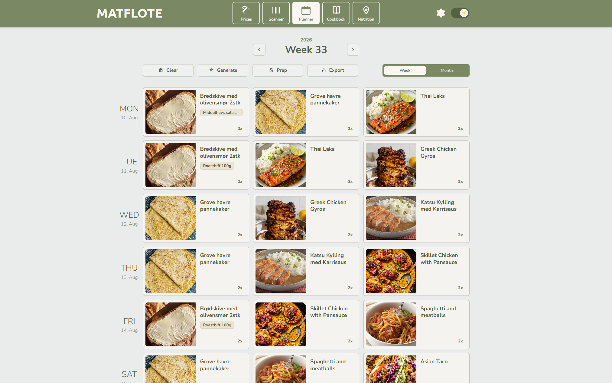
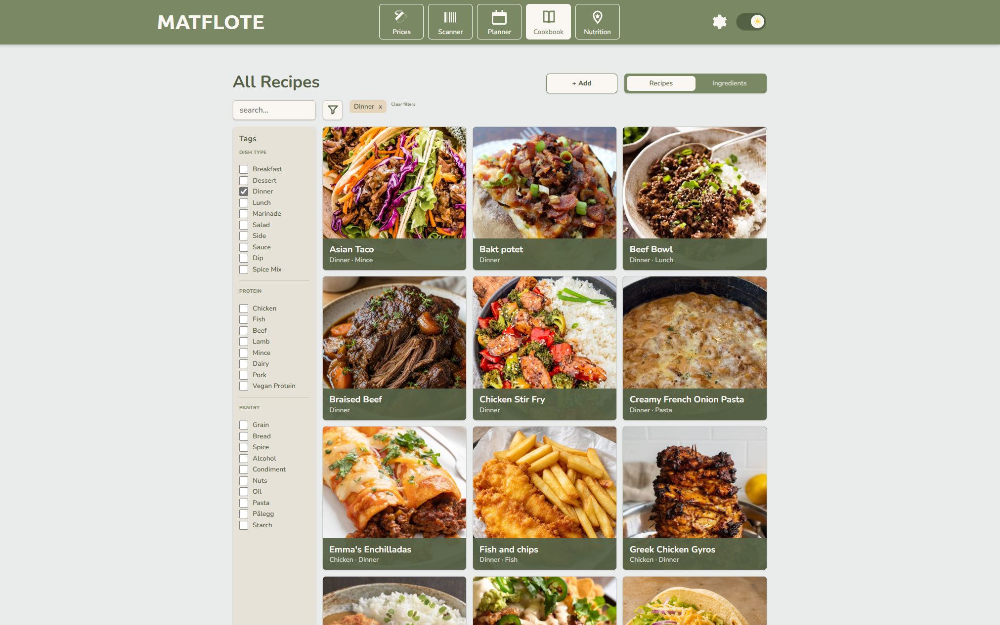
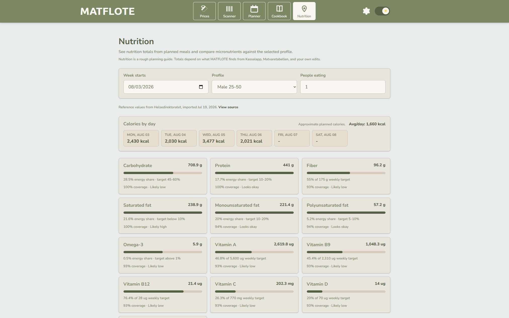
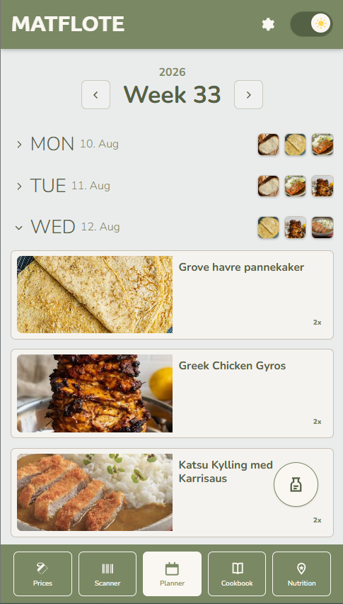
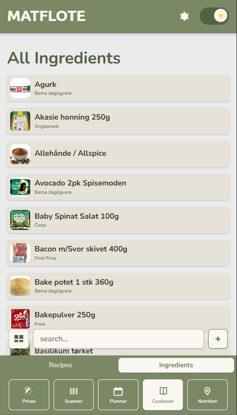

# MATFLOTE

MATFLOTE is a household meal planning and cookbook app. It is my personal tool made to be run on a personal homeserver.

Created with assistance of ChatGPT 5.5.

## Current App Features

- Cookbook with recipes and ingredients.
	- Recipes can contain ingredients and measured recipe components, so one recipe can be used like an ingredient inside another recipe.
	- Recipe ingredients/components store measurable units and preparation, such as chopped, diced, julienned, grated, or crushed.
- Meal planner
	- Prep helper for the current week. It lists produce-style ingredients only when an explicit preparation exists or one can be inferred from recipe instructions.
	- Shopping-list preview and export through the provider-based grocery-list system. Vikunja is the first supported provider.
- Scanner page for Norwegian grocery lookup by barcode/EAN through Kassalapp, with missing nutrition fields supplemented from Matvaretabellen.
- Nutrition page for approximate weekly nutrition summaries from planned meals and locally stored Helsedirektoratet reference values.

## Project Structure

- `frontend/`: React/Vite browser app.
- `backend/`: ASP.NET Core API, SQLite migrations, seed catalog import/export, image handling, and PDF generation.
- `backend.Tests/`: xUnit tests that run the API in memory against a temporary SQLite file. Run with `dotnet test` from the repository root (`Matflote.sln`).
- `backend/SeedImages/`: committed starter images and placeholders that are copied into image storage on startup.
- `docs/images/`: screenshots used by this README.
- `docker-compose.yml`: reference two-container MATFLOTE stack. The home server uses its own compose file; see [Deployment On The Home Server](#deployment-on-the-home-server).

## Images

### Planner



### Cookbook



### Nutrition



### Mobile 





## Deployment On The Home Server

MATFLOTE runs on a Raspberry Pi 4 (arm64, Debian 13) behind Nginx Proxy Manager and is reached only over Tailscale, as `https://matflote.mariuskristensen.no`. It runs as two containers:

- `matflote-frontend`: this repo's nginx (`frontend/Dockerfile`). It serves the built frontend, compresses responses, sets cache headers, and proxies `/api`, `/images` and `/health` to the backend at `http://backend:8080`.
- `matflote-backend`: the .NET 10 API (`backend/Dockerfile`). It owns the SQLite database and the image files and runs database migrations when it starts.

Requests go `https://matflote.mariuskristensen.no` → Nginx Proxy Manager (TLS) → `http://matflote-frontend:80` → `http://backend:8080`.

The server does **not** use this repo's `docker-compose.yml`. The server's own `~/infra/docker-compose.yml` builds both services from a checkout of this repo at `~/infra/matflote`, and keeps the data in bind-mounted folders:

| On the Pi | In the backend container | Holds |
| --- | --- | --- |
| `~/infra/config/matflote/data` | `/data` | `dinnerplanner.db`, its `-wal`/`-shm` files, the `.bak` copies made before migrations, and `backups/dinnerplanner.latest.db` |
| `~/infra/config/matflote/images` | `/data/images` | uploaded, imported and seeded images and their thumbnails |

The backend finds them through `ConnectionStrings__DinnerPlanner=Data Source=/data/dinnerplanner.db` and `ImageStorage__RootPath=/data/images`. The nginx config looks the backend up by the name `backend`, so the backend service must be reachable under that name on the compose network (as a network alias, for example).

### What To Mirror In `~/infra/docker-compose.yml`

This repo's `docker-compose.yml` is the reference. These parts of it belong in the server's compose file too:

```yaml
  matflote-backend:
    environment:
      TZ: Europe/Oslo
      # ...the existing variables stay as they are
  matflote-frontend:
    environment:
      TZ: Europe/Oslo
    depends_on:
      matflote-backend:
        condition: service_healthy
```

- `TZ: Europe/Oslo` on both services, as the other services on the server have. Without it the containers run on UTC, so the assistant API's idea of "today" is the previous day between midnight and 01:00 or 02:00, and the times in `.bak` names and logs are an hour or two off.
- `depends_on` with `condition: service_healthy`, so the frontend starts once the backend has finished its migrations and answers. nginx will not start if it cannot resolve `backend`.
- The health check itself does not need copying: the backend image declares it (`dotnet backend.dll --healthcheck`, which asks the app's own `/health`, because the image has no curl or wget). `sudo docker compose ps` shows the backend as `healthy` once it is up. To tune it, copy the `healthcheck:` block from this repo's compose file.

No host ports are needed; Nginx Proxy Manager reaches the frontend over the compose network.

### Updating

1. If the update contains database migrations and you want a copy beyond the automatic one, run the backup call below first.
2. Pull and rebuild (a build takes about five minutes on the Pi):

   ```bash
   cd ~/infra/matflote && git pull
   cd ~/infra && sudo docker compose up -d --build matflote-backend matflote-frontend
   ```

3. Check that the backend came up and whether a migration ran:

   ```bash
   sudo docker compose ps matflote-backend matflote-frontend       # backend shows "healthy"
   sudo docker compose logs matflote-backend | grep -i "copied the database"
   ls -lt ~/infra/config/matflote/data/*.bak | head -n 3
   ```

   Before it applies migrations, the backend writes a copy of the database beside it, named like `dinnerplanner.db.20261125-120000.bak`, and keeps the newest five. A new `.bak` file and the log line mean a migration ran; no new file means there was nothing to migrate.

4. Open **Settings → Image storage** and press **Create missing thumbnails** (Norwegian: **Lag manglende miniatyrbilder**). Grids and cards use small thumbnails, and images that existed before thumbnails were introduced, or that arrived through a package import, have none until this runs. It only creates what is missing, so it is safe to press after every deployment.

### Nginx Proxy Manager

In the MATFLOTE proxy host, keep **Cache Assets** switched **off**. When it is on, the proxy caches scripts, styles and images itself, throws away the cache headers this app sends, and keeps serving old files for up to 30 minutes after a deployment. Compression and caching are handled by the app's own nginx (`frontend/nginx.conf`).

## Backups

### Nightly Database Copy

The live database is in WAL mode, so copying `dinnerplanner.db` while the backend runs can give an inconsistent file. Ask the backend for a consistent copy instead, just before the file backup runs:

```bash
curl -fsS -X POST https://matflote.mariuskristensen.no/api/maintenance/backup
```

It writes `/data/backups/dinnerplanner.latest.db` (on the Pi: `~/infra/config/matflote/data/backups/dinnerplanner.latest.db`), replacing the previous copy, and answers with the path, size and time:

```json
{"path":"/data/backups/dinnerplanner.latest.db","sizeBytes":352256,"createdAt":"2026-11-25T02:00:01+00:00"}
```

The copy is made with SQLite's `VACUUM INTO` into a temporary file and then moved into place, so a backup that reads the folder at the same moment never sees half a file. Because it lands inside `~/infra/config`, the existing Restic job picks it up with no other change: add that one line to the backup script (`~/scripts/backup-critical.sh`) before the Restic step. `-f` makes `curl` fail on an error answer, so the script can report it.

The same call works from any container on the compose network without going through the proxy, at `http://backend:8080/api/maintenance/backup` (or `http://matflote-frontend/api/maintenance/backup`). The backend image has no curl, so run it from another container.

### Restoring The Database

1. `cd ~/infra && sudo docker compose stop matflote-backend`
2. In `~/infra/config/matflote/data`, delete `dinnerplanner.db-wal` and `dinnerplanner.db-shm` if present, and copy the file you want to restore (`backups/dinnerplanner.latest.db` or a `.bak` file) over `dinnerplanner.db`.
3. `sudo docker compose start matflote-backend`

Images are not in the database. They are plain files in `~/infra/config/matflote/images`, which the Restic job already copies.

### Moving Recipes Between Instances

For an app-level portable copy, use:

```text
GET /api/seed-catalog/export-package
```

That downloads a zip containing catalog JSON plus image files. It is the easiest way to move recipes, ingredients, tags, brands, conversion rules, and images between MATFLOTE instances. It is not a full backup: meal plans, settings and ratings are not in it.

Import that package into another MATFLOTE instance:

```bash
curl -i -X POST -F "file=@matflote-export-package.zip" "https://matflote.mariuskristensen.no/api/seed-catalog/import-package"
```

The import is additive. Matching ingredients and recipes are left alone, so it is useful for seeding or moving curated data, not for replacing a whole household database.

To make the tag list match the package instead, add `?syncTags=true`:

```text
POST /api/seed-catalog/import-package?syncTags=true
```

That deletes every tag and tag category the package does not name, and with them those tags on every recipe and ingredient. Without the parameter no tag is deleted. (Before this option existed, every package import synchronised tags.)

## Running With This Repo's Compose File

For a local or fresh install, this repo's `docker-compose.yml` runs the same two containers with Docker named volumes (`matflote-data` for `/data`, `matflote-images` for `/data/images`) and publishes the frontend on a host port:

```bash
cp .env.example .env    # set MATFLOTE_PORT and any integration keys
docker compose up -d --build
```

Then open `http://localhost:8080` (or the port set in `MATFLOTE_PORT`). Open Settings to choose the language and check the integrations:

- `VIKUNJA_API_TOKEN` for shopping-list export.
- `KASSALAPP_API_KEY` for product scanning.
- `HELSEDIREKTORATET_SUBSCRIPTION_KEY` for refreshing nutrition references.

The backup call above works the same way here, at `http://localhost:8080/api/maintenance/backup`, and writes into the `matflote-data` volume.

## Development

Backend: .NET SDK 10. `dotnet build backend`, `dotnet test` from the repository root. Creating migrations needs the `dotnet-ef` 10 tool. Frontend: Node 22 or 24, then `npm ci`, `npm run dev`, `npm run lint` and `npm run build` in `frontend/`. The dev server expects the backend on `http://localhost:5132` (`dotnet run --project backend`).

## Shopping List Export

MATFLOTE can export generated shopping lists through a provider model. Vikunja is the first supported provider; other todo systems can be added later as separate exporters without changing the grocery-list builder.

Configure Vikunja through environment variables. These values seed first-run/server config, and can later be overridden from the MATFLOTE Settings page:

```env
SHOPPING_LIST_EXPORT_PROVIDER=Vikunja
SHOPPING_LIST_EXPORT_TASK_MODE=SingleTask
VIKUNJA_BASE_URL=https://vikunja.example.com
VIKUNJA_PROJECT_ID=3
VIKUNJA_API_TOKEN=your-token-here
```

The API token must have permission to create tasks in the configured Vikunja project.

The task mode can be changed from the Settings page:

- `SingleTask`: one Vikunja task with a checklist in the description.
- `SeparateTasks`: one Vikunja task per ingredient, formatted with amount, source meals, and brand when available.

Preview the generated list without exporting:

```text
GET /api/grocerylists/preview?from=YYYY-MM-DD&to=YYYY-MM-DD
```

Export the generated list to the configured provider:

```text
POST /api/grocerylists/export?from=YYYY-MM-DD&to=YYYY-MM-DD
```

## Assistant API

MATFLOTE has a small name-based API for AI agents and scripts that create recipes and plan weeks. It works with ingredient and recipe names instead of numeric IDs, validates a whole request before saving anything, supports dry runs, and reports every problem at once.

The API describes itself. Point an agent at:

```text
GET /api/assistant
```

That returns the usage guide (also in `backend/Docs/assistant-api.md`). The endpoints are:

- `GET /api/assistant/context`: allowed units, tags and limits, plus a compact list of all ingredients and recipes with how recently each recipe was planned.
- `POST /api/assistant/recipes`: create or update recipes by name; missing ingredients can be created in the same call.
- `GET /api/assistant/recipes/{id}`: one recipe in the same shape the import accepts.
- `GET /api/assistant/meal-plan?from=YYYY-MM-DD&to=YYYY-MM-DD` and `PUT /api/assistant/meal-plan`: read and set meals by recipe name, many slots per call.

Like the rest of MATFLOTE, this API has no authentication. Anyone who can reach the server can use it, so keep MATFLOTE on a trusted network or behind a proxy that adds access control.

## Product Scanner

The Scanner page uses Kassalapp through the backend.

For local development, store the key with .NET user-secrets:

```powershell
dotnet user-secrets set "Kassalapp:ApiKey" "your-api-key-here" --project backend
```

For Docker/server use, set the key in your private `.env` or server environment:

```env
KASSALAPP_BASE_URL=https://kassal.app/api/v1
KASSALAPP_API_KEY=your-api-key-here
```

The Settings page can also store or replace the Kassalapp base URL and API key at runtime. Saved Settings values override the environment/appsettings defaults.

Manual EAN lookup and camera barcode scanning both use the same backend endpoint:

```text
GET /api/product-lookup/ean/{ean}
```

Camera scanning uses ZXing in the browser and is loaded only when the scan button is used. Phone browsers normally require MATFLOTE to be opened from a secure origin such as HTTPS before camera access works.

On phone/tablet widths, scanned product results become suggested ingredients. Choose a suggestion, edit the name, brand, image, tags, or nutrition, then confirm to save it through the normal ingredient API.

## Nutrition References

The Nutrition page compares planned meals against locally stored reference values. MATFLOTE can refresh those reference values from Helsedirektoratet HAPI, but weekly calculations use the local database so the app keeps working without a live external call.

For local development, store the HAPI subscription key with .NET user-secrets:

```powershell
dotnet user-secrets set "Helsedirektoratet:SubscriptionKey" "your-subscription-key-here" --project backend
```

For Docker/server use, set the key in your private `.env` or server environment:

```env
HELSEDIREKTORATET_BASE_URL=https://api.helsedirektoratet.no
HELSEDIREKTORATET_SUBSCRIPTION_KEY=your-subscription-key-here
```

The Settings page can also store or replace the Helsedirektoratet base URL and subscription key at runtime. Saved Settings values override the environment/appsettings defaults.

QA keys from `utvikler-qa.helsedirektoratet.no` must use:

```env
HELSEDIREKTORATET_BASE_URL=https://api-qa.helsedirektoratet.no
```

Refresh local reference values:

```text
POST /api/nutrition/reference-values/import
```


MATFLOTE currently displays weekly reference cards only for nutrients with usable reference data and realistic source coverage: carbohydrates, protein, fiber, saturated fat, monounsaturated fat, polyunsaturated fat, omega-3, and vitamins A, B9, B12, C, D, and E. Calories are shown by day without goal judgement.

Minerals are intentionally not imported or displayed yet. Ingredient nutrition follows Matvaretabellen's explicit fat fields: total fat, saturated fat, trans fat, monounsaturated fat, polyunsaturated fat, omega-3, omega-6, and cholesterol. There is no generic unsaturated fat field. The selected nutrition profile and "people eating" value are stored as household-level backend settings.

## Starter Data Catalog

Starter tags, tag categories, conversion rules, brands, ingredients, and recipes can be shipped through `backend/SeedData/catalog.json`.

Starter images and placeholders are shipped through `backend/SeedImages/`. On startup, MATFLOTE copies missing files from `backend/SeedImages/` into the configured image storage folder and serves them through `/images/...`.

Do not commit generated runtime image storage from `backend/wwwroot/images/`. In local development that folder is the default image storage location; in Docker the same role is handled by whatever is mounted at `/data/images`.

On backend startup, after database migrations, MATFLOTE imports that JSON file if it exists. Import is intentionally additive:

- Tag categories, tags, conversion rules, and brands are created when missing.
- Ingredients are matched by ingredient name plus optional brand name.
- Recipes are matched by recipe name.
- Existing matching ingredients and recipes are left alone, so user edits are not overwritten.

This means you can safely keep a starter catalog in the repository while allowing each household instance to evolve independently.

To create starter data through the app:

1. Run MATFLOTE locally.
2. Add ingredients and recipes in the UI.
3. Export the current catalog:

```text
GET /api/seed-catalog/export
```

The endpoint downloads `matflote-seed-catalog.json`. Review it, remove anything personal or experimental, then copy the curated content into `backend/SeedData/catalog.json`.

The catalog uses string enum values for tags, measurement units, preparation, and nutrition fields. Plain JSON export references image URLs but does not contain binary image files. Use the export package endpoint when you need to back up or move images too:

```text
GET /api/seed-catalog/export-package
```

Example JSON shape:

```json
{
  "tagCategories": [
    {
      "name": "Produce",
      "sortOrder": 100,
      "tags": [{ "name": "Vegetable", "sortOrder": 100 }]
    }
  ],
  "conversionRules": [],
  "brands": [],
  "ingredients": [
    {
      "ingredientName": "Carrot",
      "description": "Sweet root vegetable for soups, stews, salads, and sides.",
      "brandName": null,
      "imageUrl": null,
      "tags": ["Vegetable"],
      "nutritionPer100": null,
      "color": "#f28c28"
    }
  ],
  "recipes": [
    {
      "name": "Carrot sticks",
      "imageUrl": null,
      "description": "Simple crunchy side.",
      "instructions": "Cut carrots into batons.",
      "portions": 1,
      "ingredients": [
        {
          "ingredientName": "Carrot",
          "brandName": null,
          "amount": 140,
          "unit": "Gram",
          "preparation": "Batons"
        }
      ],
      "tags": ["Vegetable"],
      "components": []
    }
  ]
}
```
